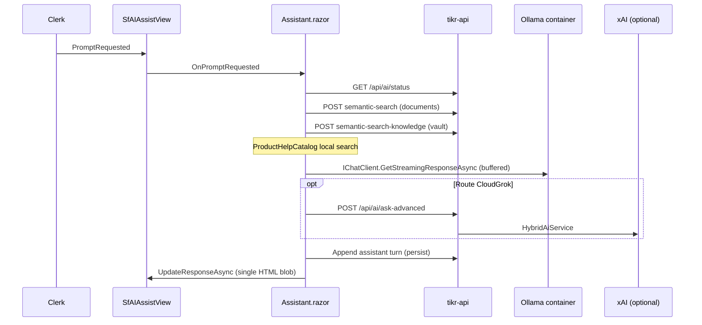

# TIKR UX evaluation (clerks on Synology NAS)

**Date:** 2026-11-15  
**Scope:** Static code audit + Release build/tests on agent VM (no live `mr-storage:8080` session).  
**Method:** Mapped Blazor routes/components, traced handlers to `TikrApiClient` / `Program.cs` / `HybridAiService`, reviewed `docker/.env.example`, `deploy/windows/*`, and production appsettings overlays.  
**RAG:** `tikr-rag-mcp` was not available in the audit environment; patterns were taken from repo search and prior docs (`docs/ui-readiness-audit.md`).

**Owner symptoms addressed:** extra UI verbiage; buttons that feel broken; AI Assistant slow and “offline-looking.”

---

## Executive summary

TIKR’s clerk workflows are **mostly wired end-to-end** (upload, requirements, vault, assistant chat, settings save). Automated tests are green (**747** tests, Release). Production pain is less “missing code” and more **UX + ops**: jargon-heavy copy, misleading labels, **toast-only “Call Steve” buttons**, config-gated Syncfusion/Ollama features without upfront disable states, and an Assistant path that **blocks the UI with no token streaming** while doing **two semantic searches** before showing “Thinking…”.

| Priority | Finding | Owner |
|----------|---------|-------|
| **Blocker** | Dashboard **“AI Scan”** only opens Requirements (no scan) | Code |
| **Blocker** | Assistant: `EnableStreaming="false"` + RAG before progress text → long dead UI | Code |
| **Must** | ~15× **Call Steve** buttons show toast only (no phone/email) | Decision + Code |
| **Must** | Calendar month view hidden when Blazor license invalid (list may still show) | Ops + Code |
| **Must** | Council packet / agenda / minutes / handover PDF need API `SYNCFUSION_LICENSE_KEY` | Ops |
| **Should** | Vault has no “Add how-to / tribal entry” for empty grids | Code |
| **Should** | Settings PageHelp + tooltips repeat Ollama/Grok/Syncfusion/DESKTOP-* hostnames | Code |
| **Should** | Footer polls AI status every **60 minutes** | Code |
| **Nice** | MainLayout error boundary **Try again** only calls `StateHasChanged()` | Code |

---

## 1. Controls inventory (pages → handler → status)

**Legend — status**

- **OK** — Handler calls API/navigation; failures surfaced in UI/logs.
- **Wired** — Works when Ollama/Syncfusion/API configured.
- **Risk** — Misleading label, silent failure, or partial effect.
- **No-op** — UI-only (toast, tooltip, layout).
- **Config-gap** — Disabled or fails without license/path/env.

**Layout & global** (`MainLayout.razor`, shared chrome)

| Page | Control label | File:line | Status | Evidence | Fix |
|------|---------------|-----------|--------|----------|-----|
| All | Nav: Dashboard … Settings | `MainLayout.razor:34-40` | OK | `NavLink` to valid `@page` routes | — |
| All | Tools tour | `MainLayout.razor:41` | OK | `/demo/clerk-tools` | — |
| All | Users (admin) | `MainLayout.razor:45` | Wired | Auth-gated | — |
| All | Hide / Show menu | `MainLayout.razor:23-30,66-73` | OK | `tikrNav.setCollapsed` JS | — |
| All | Sign out | `MainLayout.razor:56` | OK | `AuthSession.LogoutAsync` | — |
| All | Try again (error boundary) | `MainLayout.razor:92` | **Risk** | `StateHasChanged()` only | Reset child state or navigate reload |
| All | Footer status | `TikrStatusFooter.razor:7-12` | Wired | `GetLocalStorageStatusAsync`; 1-min timer | Poll 15–30s; badge near Assistant |
| All | Offline banner | `TikrOfflineBanner.razor:7-9` | OK | `LocalConnectionStateService` | — |
| All | Tour this page | `PageTourButton.razor:4` | OK | `ClerkTourService` | — |
| All | Page help (?) | `PageHelp.razor:5-7` | No-op | Tooltip only | Optional one-line drawer |

### Dashboard (`/` — `Home.razor`)

| Control label | File:line | Status | Evidence | Fix |
|---------------|-----------|--------|----------|-----|
| Reset layout | `Home.razor:23` | OK | JS `tikrDashboardLayout.remove` | — |
| User guide | `Home.razor:25` | OK | `ClerkUserGuideService.Open` | — |
| Add requirement | `Home.razor:87` | OK | Navigate `/requirements` | — |
| **AI Scan** | `Home.razor:88` | **Risk** | Same navigate as Add requirement | Navigate `/requirements` + open uploader or rename “Open AI Scan” |
| Upload document | `Home.razor:89` | Wired | `/documents?action=upload` (banner only) | Auto-scroll/focus uploader |
| Calendar / Assistant | `Home.razor:90-91` | OK | Navigation | — |
| Edit (linked doc) | `Home.razor:141-143` | Config-gap | `DocumentWorkspaceDialog` needs license | Disable + tooltip when SDK missing |

**Page help word count (clerk-visible):** ~95 words in `HelpText` alone (`Home.razor:29`); page total ~**180** words worth tightening (see §2).

### Requirements (`/requirements`)

| Control label | File:line | Status | Evidence | Fix |
|---------------|-----------|--------|----------|-----|
| Add / Export CSV | `Requirements.razor:35,38` | OK | Dialog / `ExportCsvAsync` | — |
| Council packet / Agenda / Compliance | `Requirements.razor:41-44` | Config-gap | `Api.Generate*` + Document SDK | Preflight badge; disable when `document-sdk-status` false |
| Meeting minutes / Print packet | `Requirements.razor:45-46` | Wired | Dialog + print JS | — |
| AI Scan uploader | `Requirements.razor:48-53` | Config-gap | `ScanDocumentWithAgentAsync` | Inline error when agent tools off |
| Smart Paste | `Requirements.razor:215` | Wired | `SfSmartPasteButton` + Ollama | Toast when `OllamaAvailable` false |
| Grid Edit/Delete | `Requirements.razor:197,200` | OK | CRUD APIs | — |
| Checklist / contacts / attach | `Requirements.razor:268-427` | OK | API methods | — |
| Reset Wiley view | `Requirements.razor:79` | No-op | Local filter reset | Rename “Clear filters” for clerks |

### Documents (`/documents`)

| Control label | File:line | Status | Evidence | Fix |
|---------------|-----------|--------|----------|-----|
| Library / Browse / Recycle | `Documents.razor:36-44` | OK | View mode + reload | — |
| Uploader | `Documents.razor:56-57` | OK | `OnUpload` → `UploadDocumentAsync` | — |
| Folder proposals | `Documents.razor:81-82` | OK | Accept/decline API | — |
| Semantic search | `Documents.razor:148-154` | Config-gap | Embeddings/Ollama | Disable + “indexing” message |
| Bulk delete / re-tag | `Documents.razor:168-170` | OK | Bulk API | — |
| Context menu | `Documents.razor:490+,1902` | Risk | No-op if no row selected | Hide menu when empty |
| Open Full Screen / editors | `Documents.razor:399+` | Config-gap | Syncfusion license | Same as workspace dialog |
| File Manager toolbar | `Documents.razor:210+` | Wired | `OnRead`, delete, rename | — |

### Vault (`/vault`)

| Control label | File:line | Status | Evidence | Fix |
|---------------|-----------|--------|----------|-----|
| Copy for new clerk | `Vault.razor:37-40` | Wired | Clipboard JS | Toast on permission denied |
| Handover package PDF | `Vault.razor:43-46` | Config-gap | `GenerateHandoverPackageAsync` | Disable when SDK missing |
| Contact CRUD | `Vault.razor:139-169` | OK | API | — |
| Voice note STT | `Vault.razor:261-273` | Wired | Browser mic + API create | Mic permission messaging |
| Save Changes (editor) | `Vault.razor:327` | OK | `SaveSelectedEntryAsync` | — |
| *(missing)* Add how-to/tribal | — | **Risk** | New entries only via voice/import | Add “New entry” button |

### Assistant (`/assistant`)

| Control label | File:line | Status | Evidence | Fix |
|---------------|-----------|--------|----------|-----|
| Suggestion chips | `Assistant.razor:51-53` | Wired | `OnPromptRequested` | — |
| Forget (memory) | `Assistant.razor:68-70` | OK | `DeleteAssistantMemoryFactAsync` | — |
| **Chat (SfAIAssistView)** | `Assistant.razor:84-95` | **Risk** | Buffered stream; see §3 | Streaming + immediate status |
| Clear conversation | `Assistant.razor:101` | OK | `StartNewAssistantSessionAsync` | — |
| Vault scope dropdown | `Assistant.razor:100` | Wired | Filters knowledge search | — |

### Calendar (`/calendar`)

| Control label | File:line | Status | Evidence | Fix |
|---------------|-----------|--------|----------|-----|
| Create deadline (NL) | `Calendar.razor:53-56` | Wired | `IChatClient` + create API | Spinner + Ollama-down message |
| SfSchedule | `Calendar.razor:75-92` | Config-gap | Hidden if `!BlazorLicenseValid` (`:64-71`) | Banner explains license vs empty calendar |

### Settings (`/settings`)

| Control label | File:line | Status | Evidence | Fix |
|---------------|-----------|--------|----------|-----|
| Save settings / Check status | `Settings.razor:296-297` | OK | `SaveFeaturesAsync` / `RefreshFeaturesAsync` | — |
| *(when API down)* Save hidden | `Settings.razor:90-98` | Config-gap | Only Call Steve | Retry + link to footer status |
| **Call Steve** (×15) | e.g. `Settings.razor:96,124,…` | **No-op** | `Toast.Show("Call Steve for help")` only (`:688`) | Real contact or remove button label |
| Scan shared folder | `Settings.razor:422` | Config-gap | Disabled when library path unset | — |
| Refresh Assistant memory | `Settings.razor:425` | Wired | `ReindexEmbeddingsAsync` | Progress bar (long on NAS) |
| Open tools tour | `Settings.razor:310` | OK | Navigation | — |

### Other routes

| Page | Notes |
|------|--------|
| `/demo/clerk-tools` | All buttons navigation/coaching only — **OK** |
| `/login`, `/account`, `/settings/users` | Auth flows **OK** (when auth enabled) |
| `/knowledge` | Redirect to `/vault` — no controls |
| `DocumentWorkspaceDialog.razor` | Save/download/convert/retag **wired**; license fallback `290-296` |

**Appendix — control counts (approx.):** Settings 27+ buttons; Documents 23+; Requirements 27+; Vault 19+; Assistant 3 + chat widget; Home 8. No `TODO` / `NotImplementedException` in `TIKR.Web` components.

---

## 2. Verbiage audit (clerk-facing copy)

**Rough visible copy budget** (markup + tooltips + help strings, token count upper bound):

| Page | ~Words (audit script) | Main clutter sources |
|------|----------------------:|----------------------|
| Settings | 650+ | Duplicate cards, 15× Call Steve, hostname inventory (DESKTOP-*), triple “local helper” |
| Requirements | 550+ | Agent tooltips, Syncfusion license hints, Wiley jargon |
| Documents | 480+ | File Manager tooltip essay, “semantic” / “embeddings” |
| Vault | 380+ | Tab help, STT instructions |
| Home | 260+ | Long PageHelp, Ollama/Synology tooltips |
| Assistant | 200+ | PageHelp names Syncfusion; memory instructions |
| Calendar | 250+ | License paragraph when invalid |

### Tighter rewrites (samples)

| Location | Current (summary) | Clerk rewrite (~target) |
|----------|-------------------|-------------------------|
| `MainLayout.razor:21` tagline | “The Town Clerk's Second Brain” | “Town clerk workspace” |
| `Assistant.razor:23` subtitle | “Your local deputy for town documents, the vault…” | “Ask about deadlines, files, and how to use this app.” |
| `Assistant.razor` PageHelp | Ollama, Grok, Syncfusion, Deb/Paige hostnames | “Questions stay on town equipment unless you turn on the advanced helper in Settings. Clear chat does not erase saved notes about you.” |
| `Home.razor:88` button | “AI Scan” | “Scan a form (Requirements)” or wire scan here |
| `Settings.razor` Call Steve | Button label promises a call | “Steve’s number: (xxx)…” or “Copy IT contact” |
| `TikrStatusFooter` | “Local helper ready/offline” | “Answer robot: ready / starting / off” + last checked time |
| `Documents.razor` semantic search | “Search by meaning” + Ollama tooltip | “Find similar topics” |
| `Requirements.razor:79` | “Reset Wiley view” | “Clear filters” |
| Error boundary `MainLayout.razor:90-92` | Exception type name shown | “This section hit a snag. Reload page or try again.” |

**Principle:** One idea per screen header; move technical names (Ollama, Grok, Syncfusion, embeddings, NAS hostname) to **Settings → Advanced** or a single glossary link.

---

## 3. AI Assistant — request path & fix plan

### End-to-end flow (clerk sends a message)

| Layer | Detail |
|-------|--------|
| **UI** | `Assistant.razor` → `SfAIAssistView` `EnableStreaming="false"` (`:90`) — streams from Ollama but **buffers entire reply** before one `UpdateResponseAsync` (`:471-515`). Comment at `:81-82` documents prior partial-token flash. |
| **Web host** | `Program.cs:107-112` — `OllamaApiClient` + `GetChatModel` / `GetOllamaHost` from config (`OLLAMA_HOST`, `OLLAMA_CHAT_MODEL`; default model in API `appsettings.json`: `llama3.2:3b`). |
| **Smart components** | Same `IChatClient` for Smart Paste / TextArea (`Program.cs:114-116`). |
| **API** | `HybridAiService` — chat timeout **180s** default (`TikrConfiguration.GetChatCompletionTimeoutSeconds`); embeddings same budget. `/api/ai/status` probes Ollama. |
| **Docker NAS** | `docker-compose.yml`: `tikr-web` 1 GiB, `ollama` 8 GiB; Web reaches API at `TIKR_API_URL=http://tikr-api:8080`; Ollama at `http://ollama:11434`. |
| **Blazor Server** | `SignalR` max message 100 MB (`Program.cs:122-125`); no custom circuit timeout — browser reconnect via `ReconnectModal.razor.js`. `TikrCircuitHandler` logs connection down. |
| **RAG cost** | Each prompt: **2** embedding searches + large packed user message (`BuildUserMessageWithRag`) before local model runs. |
| **Progress UX** | `args.Response = string.Empty` (`:378`) then RAG; **“Preparing…” / “Looking through your library…” only after RAG** (`:463-468`). Long silent gap. |
| **Offline appearance** | Footer hint updates **every 1 minute** (`TikrStatusFooter.razor:29-37`); Assistant does not show persistent badge; `_routeNote` is muted text after answer (`Assistant.razor:102-106`). |
| **Errors** | `SafeUpdateResponseAsync` swallows exceptions (`:662-673`); status check failure assumes Ollama up (`:389-392`). |

### Why it feels slow

1. **Sequential RAG** (two API round-trips + embedding work on J4125-class NAS CPU).
2. **No token streaming to UI** despite `GetStreamingResponseAsync` — clerk waits for full completion (up to **180s**).
3. **Cold Ollama model** after container restart (no preload in compose).
4. **Large prompts** (system + deadline context + RAG blocks + history window in `PageWorkflowHelpers`).
5. **Web container memory limit 1 GiB** — less impact than Ollama, but competes on same NAS.

### Why it looks offline / broken

1. Empty AssistView panel during RAG + inference (no spinner in control chrome).
2. “Local helper offline” only in footer, refreshed slowly.
3. No “Still working… (45s)” watchdog or cancel hint except Stop control.
4. Success path shows subtle “Answered by the local helper” — easy to miss vs chat bubble delay.

### Recommended fixes (PR-sized)

| # | Change | Effort |
|---|--------|--------|
| 1 | Set `EnableStreaming="true"` + throttle `UpdateResponseAsync` with **sanitized** partials (or custom markdown panel) | Medium |
| 2 | Show **immediate** “Thinking…” on `PromptRequested` before RAG; second line “Searching your files…” | Small |
| 3 | **Parallel** doc + vault semantic search (`Task.WhenAll`) | Small |
| 4 | Header **AI status chip** (ready / warming / offline) from `/api/ai/status` every 15s on Assistant + Dashboard | Small |
| 5 | `ollama run` **preload** on deploy (`Ensure-Ollama.ps1` pattern / compose health hook) | Ops |
| 6 | Consider smaller default model or `tikr-clerk` quant on NAS; optional Grok for long waits | Decision |
| 7 | Friendly timeout at 60–90s clerk-facing: “Still thinking—wait or try a shorter question.” | Small |
| 8 | Do not swallow `UpdateResponseAsync` — log + single fallback message | Small |

---

## 4. Build, tests, licenses, secrets

### Build & tests (audit VM)

| Step | Result |
|------|--------|
| `dotnet build TIKR.sln --configuration Release` | **Succeeded** (0 warnings / 0 errors) |
| `dotnet test TIKR.sln --configuration Release` | **747 passed**, 0 failed |

| Project | Tests |
|---------|------:|
| TIKR.Shared.Tests | 132 |
| TIKR.Web.Tests | 243 |
| TIKR.Infrastructure.Tests | 263 |
| TIKR.SyncfusionDocuments.Tests | 20 |
| TIKR.Api.Tests | 89 |

`trunk check` was not run in this audit (not required for docs-only PR).

### Syncfusion license registration

| Surface | Mechanism | Production need |
|---------|-----------|-------------------|
| **Blazor UI** | `SyncfusionLicenseBootstrap.RegisterIfConfigured` in `Program.cs:84-100`; runtime status in `SyncfusionBlazorLicenseStatus` | `SYNCFUSION_LICENSE_KEY` in Web env or saved via Settings → API |
| **Document SDK (API)** | Env `SYNCFUSION_LICENSE_KEY` on **tikr-api** | Council packet, agenda, minutes, handover PDF, some agent tools |
| **Settings UI** | Shows “Screens: looking good / needs attention” (`Settings.razor:132-133,345-346`) | v34.x Blazor key |

### Secrets in repo (redacted)

| Item | In git? |
|------|---------|
| `docker/.env` | **No** (gitignored); `docker/.env.example` has placeholders only (`your_syncfusion_license_key_here`, `xai-your_grok_api_key_here`) |
| `appsettings.Development.json` | **No** (gitignored pattern) |
| Committed `appsettings.json` | No secrets — hosts and model names only |
| Tests | Fake keys only (e.g. `unit-test-grok-key-not-a-real-credential`) |

---

## 5. Other issues

| Item | Class | Owner |
|------|-------|-------|
| Library scan disabled until `TIKR_LIBRARY_SCAN_PATH` mounted | Config-gap | Ops |
| `USE_SYNCFUSION_AGENT_TOOLS` / orchestration default **true** in `.env.example` but fails without license | Config-gap | Ops |
| Auth optional — clerks may not distinguish login-off vs broken | Decision | Ops |
| `docs/ui-readiness-audit.md` records green E2E on dev Docker — **not** synonym for NAS clerk UX | Nice | Code (link from this doc) |

---

## 6. Prioritized PR-sized work plan

| Order | PR title (suggested) | Scope | Class | Owner |
|------:|--------------------|-------|-------|-------|
| 1 | `fix/assistant-progress-and-streaming` | Immediate thinking state; parallel RAG; optional streaming | **Blocker** | Code |
| 2 | `fix/dashboard-ai-scan-label` | Rename or deep-link to Requirements uploader | **Blocker** | Code |
| 3 | `fix/settings-call-steve-contact` | Real Steve contact or honest “Copied IT info” | **Must** | Decision + Code |
| 4 | `fix/ai-status-polling` | 15s status chip Assistant + footer | **Must** | Code |
| 5 | `docs/clerk-glossary` | Single page: what “local helper” means | **Should** | Code |
| 6 | `fix/vault-add-entry` | New how-to/tribal button | **Should** | Code |
| 7 | `chore/copy-pass-settings-requirements` | Apply §2 rewrites | **Should** | Code |
| 8 | `ops/nas-ollama-warmup` | Document + script preload on NAS boot | **Should** | Ops |
| 9 | `fix/error-boundary-reload` | Meaningful recovery in `MainLayout` | **Nice** | Code |

---

## References (code)

- Assistant pipeline: `src/TIKR.Web/Components/Pages/Assistant.razor`
- Web AI wiring: `src/TIKR.Web/Program.cs`
- API AI endpoints: `src/TIKR.Api/Program.cs` (`/api/ai/*`)
- Timeouts: `src/TIKR.Shared/Configuration/TikrConfiguration.cs` (`GetChatCompletionTimeoutSeconds`)
- NAS compose: `docker/docker-compose.yml`, `docker/.env.example`
- Production Web overlay: `deploy/windows/appsettings.Production.Web.json`